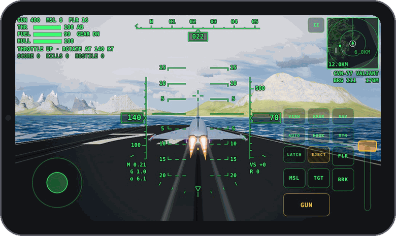
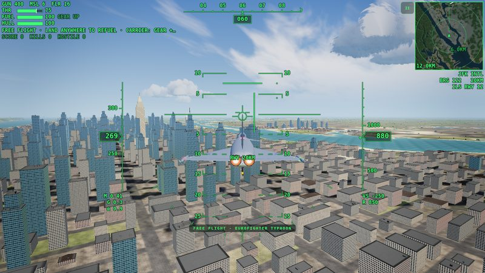
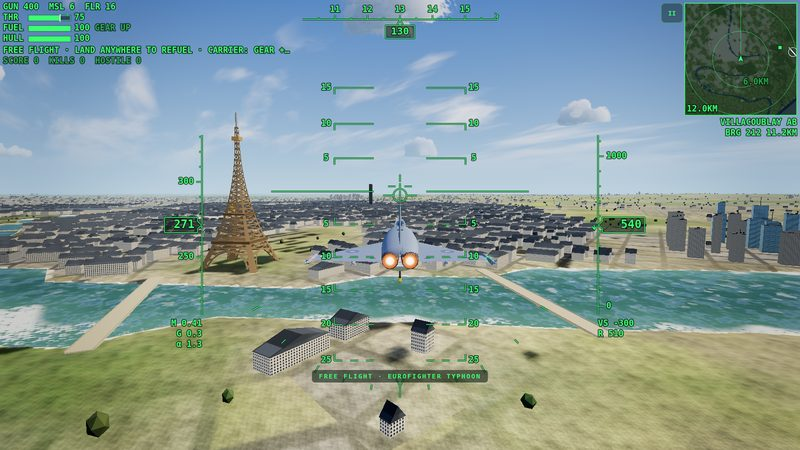
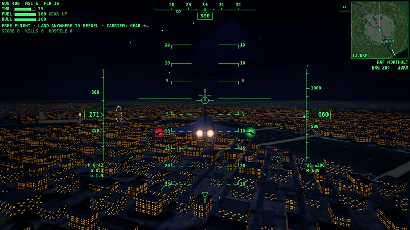
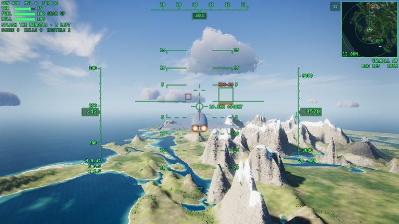
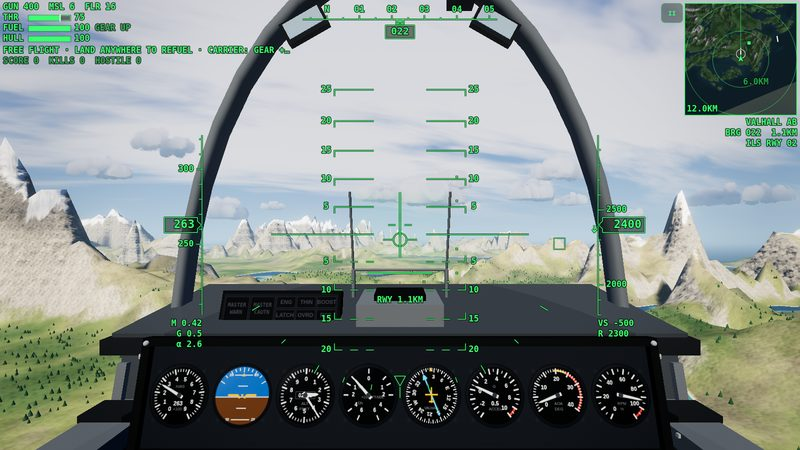
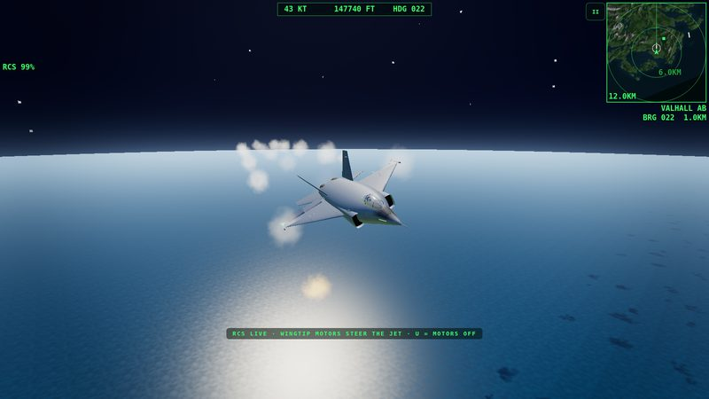

# OpenWings — browser flight / air-combat sim (v2)

**▶ Play it now: https://mrober01.github.io/OpenWings/** (phone or PC, nothing to install)

**📲 Install it as an app (phone):** open the link in Chrome and tap **INSTALL APP** in the hangar (or ⋮ → *Install app* /
*Add to Home screen*). It opens full-screen from the home screen, plays offline, updates itself when you're online, and
keeps **tilt-to-fly** (phones only give the motion sensor to the https site, not to a downloaded file).

**⬇ Download the game file (offline / phone copy):** [OpenWings.html](https://github.com/mrober01/OpenWings/releases/latest/download/OpenWings.html), open it in any browser (everything but tilt-to-fly)

<p align="center"></p>

📱 **Made for phones first.** Open the link on your phone, turn it sideways and fly: thumb stick on the left, throttle and
weapons on the right (or tilt-to-fly). Nothing to install, no account, and the downloaded file works offline. Just as good on a
PC with keyboard, mouse or gamepad.

| | | |
|---|---|---|
|  |  |  |
|  |  |  |

A self-contained 3D flight simulator that runs in any modern browser, built
**phone-first** (landscape, touch), in the spirit of the 90s combat flight sims. No server, no accounts,
no internet: everything is procedural and the whole game builds into **one HTML file**.

- **9 flyable aircraft**: Eurofighter Typhoon, F-22, Su-35, MiG-29, A-10, Mi-24 Hind,
  Spitfire, Cessna 172, Airbus A320
- **8 missions**: Free Flight, Air Race, Dogfight, Ground Strike (AAA + SAMs), Intercept (bombers),
  Wave Assault (with a wingman), Landing Challenge (ILS, graded), Carrier Landing (catch the 3 wire) — three difficulty levels, best scores saved
- **Air Race**: a pylon course low over every map, in any aircraft. Fly the gates in order: blue wings level, red in
  knife-edge. Going over a gate, the wrong attitude, clipping a pylon (they rip, and it dents your aeroplane) or missing a
  gate costs seconds. Rookie / Veteran are the arcade version: big gates ~150-200 m wide and tall, lit by a light
  curtain, a dotted racing line, gate assist (nudges you toward the next gate when you're lined up), Auto-GCAS
  (pulls you up before you hit the ground), soft penalties; both follow the ASSIST option (OFF = no help). Ace is
  real race size with full penalties, no assists.
  SHARE MY TIME at the finish (phone share sheet, or copy). 3-2-1-GO countdown, clean-gate streak multiplier,
  split times against your best run, a ghost of your best run to race, race smoke, gold / silver / bronze against par,
  your top 5 times per course. A gunnery range along the course: big bullseye strafing boards scored by ring, tethered
  balloons (gold ones take a second off your time), range targets on the ground and a target drone overhead. Same map +
  aircraft + difficulty = same course, so you can compare scores with friends
- **Aircraft carrier** on every map: catapult launches off the bow, tail hook + four arrestor wires on the angled deck,
  bolters, ramp strikes, the deck crew re-spots you on the cat after a trap
- **Wingman**: call one up and it joins on your wing and stays there through every turn and roll, even when you take off
  and land. Order airshow stunts: it slides in close and waves, flies inverted canopy-to-canopy over you (Top Gun style),
  barrel-rolls around you, does a victory roll, or switches on airshow smoke. In the cockpit your head turns to watch
- **Autopilot**: take off, land (runway or carrier, with go-arounds), go to space (the hung-missile booster run, all by
  itself), tour the map's landmarks, attack the nearest target, hold altitude/heading
- **Flight model** with real g, energy bleed, stall, fly-by-wire assist; AI flies the same physics
- **Fighter HUD** (pitch ladder, flight-path marker, target box, lead-computing gun sight, missile lock, ILS, moving-map radar)
- **3D cockpit**, chase / padlock / fly-by / orbit views, drag to look around
- Eight 40 km maps — four made-up worlds (Nordic fjords, desert canyons, tropical islands, a Pacific carrier group) and four real cities at 1:1 scale:
  - **New York**: Manhattan's grid, Empire State, Chrysler, One WTC, Statue of Liberty, Brooklyn / Manhattan / Williamsburg / George Washington / Verrazzano bridges; from JFK, LaGuardia or Newark
  - **Paris**: the Seine, Eiffel Tower (floodlit at night), Arc de Triomphe, Notre-Dame, Sacré-Cœur, the Louvre, Les Invalides, Montparnasse, La Défense and the Grande Arche, the Seine bridges; from Villacoublay, Orly or Charles de Gaulle
  - **London**: the Thames, Westminster and Big Ben, the London Eye, Tower Bridge, the Shard, St Paul's, the Gherkin, Battersea, the O2, the Thames bridges; from RAF Northolt, Heathrow or London City
  - **Rio de Janeiro**: real mountain terrain, Christ the Redeemer on Corcovado, Sugarloaf and its cable car, the Rio–Niterói bridge, Maracanã, Copacabana; from Afonsos AB, Galeão or Santos Dumont
- Every map has three airfields, a carrier and a city; five times of day / weather; free flight can start from any airfield, the carrier or airborne
- Solid, destructible cities: smash through houses (towers stop you), shoot buildings apart
- Detailed airframes: panel seams and rivets, sky reflections on paint and canopies, pilots, visible missiles
- Procedural sound, haptics, gamepad support

## Play it on a phone

```bash
npm install
npm run phone      # → dist/OpenWings.html  (one ~1 MB file, works offline)
```

Copy `dist/OpenWings.html` to the phone (USB, cloud drive, e-mail…) and open it in the
browser, or serve it: `cd dist && python3 -m http.server` → `http://<pc-ip>:8000/OpenWings.html`.
Hold the phone in landscape. (`dist/index.html` is the same build and is kept in git.)

## Development

```bash
npm run dev        # vite dev server → http://localhost:5173  (hard-refresh after edits)
npm test           # node tests: flight envelope + AI
node tests/play.mjs    # headless Chrome: an AI pilot flies every mission, fails on errors
node tests/race.mjs    # headless Chrome: air-race course on every map + scoring (--fly: a bot flies it)
node tests/carrier.mjs # headless Chrome: catapult, autopilot traps / landings / take-offs / space run / attack / RCS
node tests/shots.mjs   # headless screenshots → /tmp/ow-shots/
```

Requires Node 18+. The repo also runs straight from a static file server without a
bundler (`index.html` has an importmap for the vendored Three.js).
Docs for contributors: `docs/ARCHITECTURE.md` (module map) and `docs/INTERFACES.md` (module contracts).

## Controls

### Touch

| Control | Action |
|---|---|
| Left thumb, anywhere on the left side | Floating stick — pull **down** = nose up (can be inverted) |
| Slider at the right edge | Throttle; push past the amber mark for afterburner |
| Drag on the sky | Look around (springs back) |
| GUN (hold) · MSL · FLR | Cannon · missile (needs a lock) · flares |
| TGT | Cycle target — keep it in front until the diamond closes and you hear the tone |
| BRK (hold) | Speed brake (also on the ground, with the wheel brakes) |
| GEAR · VIEW · NAV | Gear · next view · next airfield (or the carrier) for the nav/ILS readout |
| AUTO | Autopilot menu: take off · land · go to space · next landmark · attack target · hold · off. While it flies, drag anywhere (left side too) to look around; AUTO → OFF to take over |
| WING | Wingman menu: call / dismiss · swap side · close in & wave · inverted overhead · barrel roll around you · victory roll · smoke |
| HOOK | Tail hook for carrier landings |
| LATCH · MTR | Pylon latches (missiles stay on the rails as rocket boosters; hold = burn-limiter override) · motor cut-off / relight |
| ⏸ (top right) | Pause |

Optional **TILT TO FLY** (hangar options): lean the phone to bank; tip the top edge toward you
to climb, away to dive (INVERT Y flips it). It re-zeroes each time you press FLY or resume.
Phones only give the motion sensor to https pages, so tilt works from the online link, not a
downloaded file. Experimental.

### Keyboard / mouse

| Action | Key |
|---|---|
| Pitch / roll / rudder | `W` `S` / `A` `D` / `Q` `E` (or arrows) |
| Throttle | `Shift` up, `Ctrl` down; `1`–`4` presets, `5` afterburner |
| Gun / missile / flares | `Space` / `X` / `F` |
| Target / nav airfield | `T` / `N` |
| Gear / brake / tail hook | `G` / `B` / `K` |
| Autopilot | `O` opens the menu, then `1`–`6` (`0` = off). While it flies the mouse looks around; any flight key (`W` `A` `S` `D` …) takes over |
| Wingman | `Y` opens the menu, then `1` call / dismiss · `2` swap side · `3` close in & wave · `4` inverted overhead · `5` barrel roll around you · `6` victory roll · `7` smoke (`0` = close) |
| Pylon latches / motor cut-off | `H` (hold = burn-limiter override) / `U` |
| View | `V` (chase → cockpit → padlock → fly-by → orbit); mouse wheel = camera distance; `I` hides the HUD |
| Look | right-mouse drag; click the view to use the mouse as a stick |
| Pause | `Esc` or `P` |

A standard gamepad also works (left stick fly, right stick look, RT gun, B missile,
X flares, Y target, bumpers throttle, LT brake, Back/Select cycles the autopilot modes).

## Flying tips

- Take-off: full throttle, pull gently at ~140 kt (the HUD speed tape is in knots). Gear up with GEAR.
- With **ASSIST ON** the jet holds its flight path when you let go of the stick and will not stall. Switch it in the hangar options or with the **ASST** button next to pause (lit = on), the **L** key, or the pause menu mid-flight.
- Fight at corner speed (~300–400 kt in the fighters); pulling hard bleeds energy fast.
- Missile warning tone? Break hard across the missile and pump flares.
- Landing: gear down, follow the ILS bars to the runway, ~150 kt over the threshold, throttle to idle (auto-brakes).
  Stop on any friendly runway to refuel, rearm and repair.
- Carrier: on the catapult go to full power (or afterburner) and hold it — the cat fires after a second. To land: gear
  and hook down, ~120 kt, follow the ILS bars to the angled deck and fly it straight into the deck — **no flare**.
  Miss the wires (bolter)? Power up and go around. Throttle to idle in the wire and the deck crew re-spot you on the cat.
- Space: lock the pylon latches (LATCH), hold LATCH to override the burn limiter, zoom up steeply and fire the missiles
  in pairs. With the latches locked the two wingtip rounds work as **RCS thrusters**: up where the air is too thin for
  the controls, the stick still turns the jet (hands off = hold attitude). MTR / `U` cuts the motors (they keep their
  remaining burn) and relights them. Or just pick GO TO SPACE on the autopilot.
- Wingman: set **WINGMAN ON** in the hangar to have one on every flight. On a runway start it's parked beside you, so you get
  a formation take-off. Fly straight and level for the close stunts. If you pull hard, the formation opens up for safety.
  Stunts you order while it's still joining up are flown as soon as it reaches your wing.

## License

MIT, see `LICENSE`. Three.js (vendored) is MIT too. Everything else (terrain, aircraft, sounds) is generated in code.

The real-city maps use coastlines, rivers, parks and runways from **© OpenStreetMap contributors**
(ODbL, https://www.openstreetmap.org/copyright), and Rio's terrain from NASA SRTM via OpenTopoData,
baked into `src/world/real/*.data.js` by `node tools/realmap.mjs <city>`.
